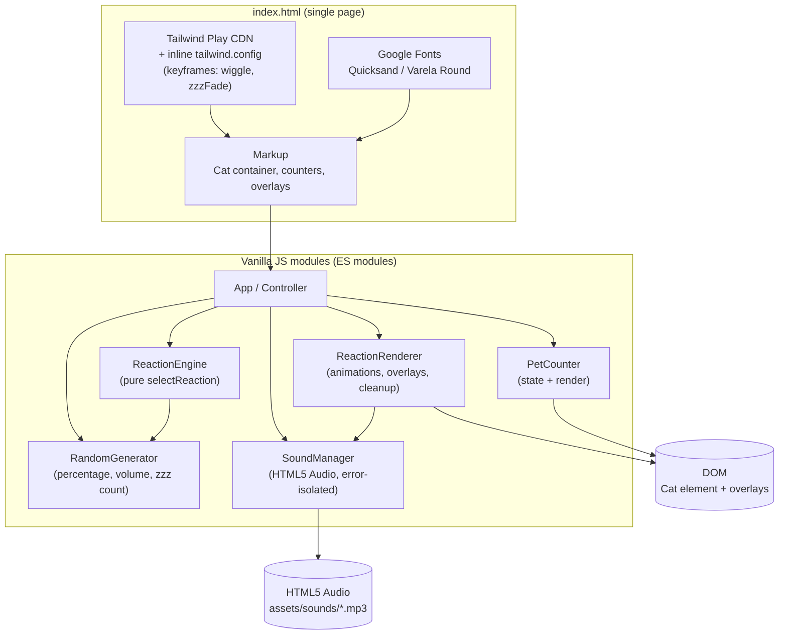
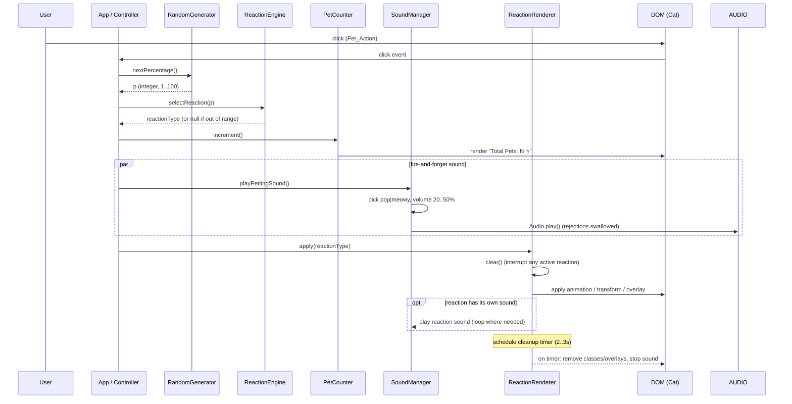

# Design Document

## Introduction

This document defines the technical design for the Cat Petting Clicker, a single-page web application built with HTML5, Tailwind CSS (via the Play CDN), and Vanilla JavaScript. The user pets a central, cute, minimalist cat by clicking it, which triggers one of four weighted random reactions (Happy, Purring, Sleeping, Zoomies), plays a sound, and increments a pet counter. The design covers the architecture, components, interfaces, data models, correctness properties, error handling, and testing strategy.

## Overview

The Cat Petting Clicker is a zero-build, browser-only single-page application. There is no server, no bundler, and no framework — the entire experience is delivered from static files: one HTML document, a small set of Vanilla JavaScript modules, and a handful of audio assets. Tailwind CSS is loaded via the Play CDN and configured inline with custom keyframe animations.

The central interaction is a single click on the Cat. On each click (a Pet_Action) the app performs four things, largely in parallel:

1. Generates a random percentage in the inclusive range 1–100.
2. Maps that percentage to exactly one reaction via a pure function (the Reaction Engine).
3. Increments the Pet Counter and re-renders it.
4. Plays a petting sound (pop or meowy) whose failures never block the rest of the flow.

The selected reaction is then rendered: an animation and/or transform is applied to the Cat, an overlay (text or emoji) is shown, and any reaction-specific sound is played. Each reaction has a finite duration after which it cleans itself up, and a new reaction cleanly interrupts any in-progress one.

### Key Design Decisions and Rationale

- **Vanilla JavaScript, no framework**: The requirements specify Vanilla JavaScript and a single-page experience. A framework would add weight and a build step for a feature this small.
- **Tailwind Play CDN over a compiled build**: The requirements explicitly use Tailwind via CDN. The Play CDN reads utility classes from the DOM and generates CSS at runtime, and it accepts an inline `tailwind.config` object so custom keyframes/animations can be registered without a build step. Trade-off: this is intended for development/prototyping, not high-volume production, which is acceptable for this app.
- **Pure functions separated from DOM logic**: The Reaction Engine mapping, the random-number/volume/count generators, and the counter logic are written as pure functions with no DOM or `Audio` dependencies. This makes them the targets of property-based testing and keeps the side-effectful layers (rendering, sound) thin and easy to mock.
- **Dependency injection for randomness**: The Reaction Engine and generators accept an injectable random source. Production uses `Math.random`; tests inject deterministic or property-based generators. This is what makes the weighted mapping testable as a universal property rather than a flaky statistical check.
- **Fire-and-forget sound with swallowed rejections**: Browser autoplay policies and missing/corrupt audio files make `Audio.play()` an unreliable side effect. Every sound call is wrapped so that a rejection or load error is logged and ignored, never interrupting the reaction or counter (Requirements 2.4, 5.3, 7.4).

## Architecture

The app is organized as a thin event-driven controller coordinating small, single-responsibility modules. Pure logic (Reaction Engine, generators, counter math) lives in dependency-free modules; impure logic (DOM rendering, audio) lives in modules that depend only on the browser APIs.



### Pet Action Flow

The following sequence shows what happens on a single click of the Cat. The sound step runs in parallel (fire-and-forget) and cannot block the reaction or counter.



## Components and Interfaces

### App / Controller (`js/app.js`)

The entry point and orchestrator. It owns the DOM references, wires the click handler on the Cat, and coordinates the other modules on each Pet_Action.

- `init()` — query DOM elements, attach the click listener, render the initial counter (`Total Pets: 0 ⭐`).
- `handlePetAction()` — the click handler:
  1. `percentage = rng.nextPercentage()`
  2. `reaction = reactionEngine.selectReaction(percentage)`; if `null`, return early (no crash).
  3. `petCounter.increment()`
  4. `soundManager.playPettingSound()` (fire-and-forget).
  5. `reactionRenderer.apply(reaction)`.

### ReactionEngine (`js/reaction-engine.js`)

A pure module exporting the weighted mapping. It contains no DOM or `Audio` references and is the primary target for property-based testing.

- `REACTION_RANGES` — a static table mapping each reaction to its inclusive `[min, max]` percentage range:
  - Happy: `[1, 40]`
  - Purring: `[41, 70]`
  - Sleeping: `[71, 90]`
  - Zoomies: `[91, 100]`
- `selectReaction(percentage) -> ReactionType | null` — returns exactly one reaction for any integer in `[1, 100]`; returns `null` (and never throws) for any value outside that range or any non-integer.

### RandomGenerator (`js/random.js`)

Wraps randomness behind small, injectable, bounded functions so bounds are enforceable and testable.

- `nextPercentage() -> integer in [1, 100]` — `1 + floor(random() * 100)`.
- `nextPettingVolume() -> number in [0.2, 0.5]` — maps a random draw to the 20–50% volume band (`0.2 + random() * 0.3`).
- `nextPettingCue() -> 'pop' | 'meowy'` — uniform pick.
- `nextZoomiesCue() -> 'zoom' | 'boing'` — uniform pick.
- `nextZzzCount() -> integer in [1, 3]` — `1 + floor(random() * 3)`.
- All functions accept an optional `random` source (defaults to `Math.random`) for deterministic/property-based tests.

### PetCounter (`js/pet-counter.js`)

Holds the pet count and renders it.

- State: `count` — non-negative integer, initial `0`.
- `increment() -> number` — `count += 1`; re-renders; returns the new count.
- `render() -> string` — sets the counter element text to `Total Pets: ${count} ⭐`.
- `getCount() -> number`.

### SoundManager (`js/sound-manager.js`)

Plays cues via HTML5 `Audio` objects and isolates every failure.

- `play(cue, { volume, loop }) -> HTMLAudioElement | null` — constructs `new Audio('assets/sounds/<cue>.mp3')`, sets `volume` (clamped to `[0, 1]`) and `loop`, calls `play()`, and attaches a `.catch()` so rejection is swallowed. Returns the element (or `null` on construction/load error).
- `playPettingSound()` — `play(nextPettingCue(), { volume: nextPettingVolume() })`.
- `playReactionSound(reaction)` — Purring: `play('purr', { volume: 0.5, loop: true })`; Zoomies: `play(nextZoomiesCue(), { volume: 0.5 })`.
- `stop(audio)` — `pause()` + reset `currentTime` to `0`, wrapped so errors are swallowed.

### ReactionRenderer (`js/reaction-renderer.js`)

Applies and cleans up the visual + audible effects of a reaction, including interruption of a previous one.

- State: `active` — a handle to the currently running reaction (`{ type, timers: [], audios: [], elements: [] }`) or `null`.
- `apply(reactionType)`:
  1. `clear()` — interrupt/cleanup any active reaction first (Requirement 4.3).
  2. Branch on `reactionType`:
     - **Happy** — add `animate-bounce` to the Cat; create a Text_Overlay reading `YAY!😊 (+5 Aura)` above the Cat; schedule removal of both after `>= 2000 ms` (Requirement 4.1, 4.2).
     - **Purring** — add `animate-pulse` to the Cat; `soundManager.playReactionSound('purring')`; schedule stopping the sound and removing the class after `2000 ms` (Requirement 5.1, 5.2).
     - **Sleeping** — add `scale-90 rotate-6` to the Cat; create `nextZzzCount()` `Zzz...` emojis above the Cat, each with the `zzz-fade` animation (Requirement 6.1, 6.2, 6.3).
     - **Zoomies** — add the `wiggle` animation to the Cat; create `>= 4` speed-line emojis positioned within `100 px` of the Cat bounding box; `soundManager.playReactionSound('zoomies')`; schedule cleanup after a duration in `[2000, 3000] ms` (Requirement 7.1, 7.2, 7.3).
  3. Record timers/audios/elements in `active`.
- `clear()` — `clearTimeout` all timers, remove all reaction-specific classes/elements, and `stop()` all audios; set `active = null`.

### Tailwind Config (inline in `index.html`)

Registered inline as `tailwind.config = { theme: { extend: { ... } } }`:

- `fontFamily`: `sans: ['Quicksand', 'Varela Round', 'sans-serif']`.
- `keyframes`:
  - `wiggle` — `>= 2` stops producing a horizontal `translate-x` shake of `10–20 px` (e.g. `'0%, 100%': { transform: 'translateX(-15px)' }`, `'50%': { transform: 'translateX(15px)' }`).
  - `zzzFade` — `>= 2` stops fading `Zzz...` emojis in (e.g. `'0%': { opacity: '0', transform: 'translateY(10px) scale(0.8)' }`, `'100%': { opacity: '1', transform: 'translateY(-10px) scale(1)' }`).
- `animation`:
  - `wiggle: 'wiggle 0.1s linear infinite'` — a `0.1 s` full cycle yields a `50 ms` half-cycle interval, satisfying the `<= 50 ms` interval constraint; the render timer bounds total duration to `2–3 s`.
  - `zzzFade: 'zzzFade 1.5s ease-in-out forwards'`.
- The config maps the requirement's "Wiggle" / "Zzz fade-in" animation names to the `wiggle` / `zzzFade` utilities (`animate-wiggle`, `animate-zzz-fade`).

## Data Models

### ReactionType

An enumerated set of the four reactions.

```js
const ReactionType = {
  HAPPY: 'happy',
  PURRING: 'purring',
  SLEEPING: 'sleeping',
  ZOOMIES: 'zoomies',
};
```

### ReactionRange

Static mapping of each reaction to its inclusive percentage range.

```js
const REACTION_RANGES = {
  [ReactionType.HAPPY]:    { min: 1,  max: 40  },
  [ReactionType.PURRING]:  { min: 41, max: 70  },
  [ReactionType.SLEEPING]: { min: 71, max: 90  },
  [ReactionType.ZOOMIES]:  { min: 91, max: 100 },
};
```

### ReactionConfig

Per-reaction presentation descriptor consumed by the renderer.

```js
// Happy
{ animationClass: 'animate-bounce',
  overlay: { kind: 'text', text: 'YAY!😊 (+5 Aura)' },
  durationMs: 2000 }

// Purring
{ animationClass: 'animate-pulse',
  sound: { cue: 'purr', volume: 0.5, loop: true },
  durationMs: 2000 }

// Sleeping
{ transformClasses: ['scale-90', 'rotate-6'],
  overlay: { kind: 'zzz', count: nextZzzCount(), animationClass: 'animate-zzz-fade' } }

// Zoomies
{ animationClass: 'animate-wiggle',
  overlay: { kind: 'speed-lines', minCount: 4, maxDistancePx: 100 },
  sound: { cue: nextZoomiesCue(), volume: 0.5, loop: false },
  durationMs: 2500 }   // within 2000..3000
```

### PetState

```js
{ count: number /* non-negative integer, initial 0 */ }
```

### SoundCue

```js
{ cue: 'pop' | 'meowy' | 'purr' | 'zoom' | 'boing',
  volume: number /* 0..1 */,
  loop: boolean }
```

## Correctness Properties

*A property is a characteristic or behavior that should hold true across all valid executions of a system — essentially, a formal statement about what the system should do. Properties serve as the bridge between human-readable specifications and machine-verifiable correctness guarantees.*

PBT applies to the pure logic of this app — the Reaction Engine mapping, the bounded random generators, and the counter math. UI rendering, animation timing, and sound playback are side-effectful and are covered by example-based and mock-based tests instead (see Testing Strategy).

### Property 1: Reaction partition is complete and disjoint

*For any* integer `p` in the inclusive range `1..100`, `selectReaction(p)` SHALL return exactly one of `Happy`, `Purring`, `Sleeping`, or `Zoomies`, and across all `p` the returned reactions SHALL correspond to four disjoint, contiguous ranges that partition `1..100` with no gaps and no overlaps.

**Validates: Requirements 3.1, 3.2, 3.3, 3.4, 3.5**

### Property 2: Out-of-range inputs do not crash

*For any* input `p` that is not an integer in `1..100` (negatives, values greater than 100, non-integers, `NaN`, non-numbers), `selectReaction(p)` SHALL return a no-reaction sentinel (`null`) and SHALL not throw.

**Validates: Requirements 3.6**

### Property 3: Generated percentage is always in range

*For any* call to `nextPercentage()`, the result SHALL be an integer and `1 <= result <= 100`.

**Validates: Requirements 2.1**

### Property 4: Petting sound volume is always in the 20–50% band

*For any* call to `nextPettingVolume()`, the result SHALL be a number in the inclusive range `0.2 <= result <= 0.5`.

**Validates: Requirements 2.2**

### Property 5: Counter increment updates count and display

*For any* current non-negative integer count `n`, after `increment()` the count SHALL be `n + 1` and the rendered text SHALL equal `` `Total Pets: ${n + 1} ⭐` ``.

**Validates: Requirements 2.3, 9.1, 9.2**

### Property 6: Sleeping Zzz count is bounded

*For any* Sleeping reaction, the number of `Zzz...` emojis generated SHALL be an integer in the inclusive range `1..3`.

**Validates: Requirements 6.3**

### Property 7: Zoomies speed-lines stay within proximity

*For any* Cat bounding box and generated speed-line offset, the placed speed-line center SHALL lie within `100 px` of the Cat element's bounding box, and at least `4` speed-lines SHALL be generated.

**Validates: Requirements 7.2**

## Error Handling

- **Out-of-range percentage (Requirement 3.6)**: `selectReaction` returns `null` and never throws. The controller treats `null` as "no reaction this click" and skips rendering while still allowing the counter and sound to proceed. Because the production generator only ever produces `1..100`, this path is defensive; it is exercised by property tests with invalid inputs.
- **Sound play/load failure (Requirements 2.4, 5.3, 7.4)**: every `Audio.play()` call is followed by an attached `.catch()` handler that logs the failure and discards it. `Audio` construction is wrapped in `try/catch` so a missing/corrupt file or an unsupported environment returns `null` rather than throwing. Failures never interrupt the Reaction Engine, the counter, or the animations.
- **Autoplay policy**: browsers may block `Audio.play()` until a user gesture. Because every sound is triggered from a click (a user gesture), playback is permitted; if a browser still rejects, the swallowed rejection keeps the flow intact.
- **Reaction interruption (Requirement 4.3)**: `ReactionRenderer.apply` calls `clear()` before applying a new reaction, which cancels pending cleanup timers, removes reaction-specific classes/elements, and stops reaction audios. This prevents overlapping animations and orphaned overlays on rapid clicking.
- **Timer cleanup**: each reaction schedules a single cleanup timer; `clear()` cancels it so timers never fire after a reaction is interrupted or replaced.
- **Value clamping**: `SoundManager.play` clamps `volume` to `[0, 1]` so an out-of-band volume cannot produce an invalid `Audio.volume`.

## Testing Strategy

The app uses a dual approach: property-based tests for pure logic, and example/mock-based tests for rendering, timing, and side effects. The PBT library is **fast-check**, run via Node's built-in test runner (`node --test`) against the DOM-free modules (which are plain ES modules), with DOM/integration tests run in a browser test harness or jsdom.

### Property-Based Tests (fast-check, minimum 100 iterations per property)

Each property test implements exactly one design property and is tagged with a comment referencing it. Tag format: `Feature: cat-petting-clicker, Property {number}: {property_text}`.

- **Property 1 — Reaction partition** (`Feature: cat-petting-clicker, Property 1: Reaction partition is complete and disjoint`): generate random integers `p` in `1..100`; assert `selectReaction(p)` returns exactly one reaction and that the implied ranges are disjoint and contiguous, covering `1..100`.
- **Property 2 — Out-of-range no-crash**: generate invalid `p` (negatives, `>100`, floats, `NaN`, non-numbers); assert `selectReaction(p)` returns `null` and does not throw.
- **Property 3 — Percentage range**: call `nextPercentage()` repeatedly; assert each result is an integer in `1..100`.
- **Property 4 — Petting volume range**: call `nextPettingVolume()` repeatedly; assert each result is in `[0.2, 0.5]`.
- **Property 5 — Counter increment + display**: generate random `n >= 0`; assert `increment()` yields `n + 1` and the rendered text equals `` `Total Pets: ${n + 1} ⭐` ``.
- **Property 6 — Zzz count bounds**: generate Sleeping reactions; assert the Zzz count is an integer in `1..3`.
- **Property 7 — Speed-line proximity**: generate random Cat bounding boxes and offsets; assert each placed speed-line center is within `100 px` of the box and at least `4` are produced.

### Example-Based / Mock-Based Unit Tests

- **Requirement 1 (UI rendering)**: assert the cat container is `aspect-square`, the cat occupies `>= 50%` of it (1.1); the background gradient resolves to `#FFDEED -> #B5FFFC` (1.2); counter elements carry `bg-white/30`, `backdrop-blur-lg`, `rounded-full`, `border-white/40` (1.3); the loaded font is Quicksand or Varela Round (1.4).
- **Requirement 2.4 (sound failure continues)**: mock `Audio.play()` to reject; perform a pet action; assert the counter incremented and a reaction rendered.
- **Requirements 4.1–4.3 (Happy)**: trigger Happy; assert `animate-bounce` present and overlay text `YAY!😊 (+5 Aura)`; advance fake timers `>= 2000 ms`; assert both removed. Then trigger Happy followed by another reaction before cleanup; assert the bounce and overlay are cleared (interruption).
- **Requirements 5.1–5.3 (Purring)**: trigger Purring; assert `animate-pulse` present; mock audio and assert `purr.mp3` plays at volume `0.5` with `loop = true`; advance `2000 ms`; assert the class removed and audio stopped. Repeat with a rejecting mock to confirm the animation still runs.
- **Requirements 6.1–6.3 (Sleeping)**: trigger Sleeping; assert `scale-90` and `rotate-6` on the cat; assert Zzz elements carry the `zzz-fade` animation class.
- **Requirements 7.1, 7.3, 7.4 (Zoomies)**: assert the `wiggle` keyframe displacement is `10–20 px` and the half-cycle interval is `<= 50 ms` (inspect config); trigger Zoomies; assert `animate-wiggle` applied and `>= 4` speed-lines within `100 px`; mock audio and assert one of `zoom`/`boing` plays; repeat with a rejecting mock to confirm animation and speed-lines still render; advance `2–3 s`; assert cleanup.
- **Requirements 8.1–8.4 (custom keyframes)**: assert `tailwind.config.theme.extend.keyframes.wiggle` and `zzzFade` each have `>= 2` stops; assert Zoomies applies `animate-wiggle` and Sleeping applies `animate-zzz-fade` (the registered utilities).
- **Requirement 9.1 (initial state)**: assert the initial counter text is `Total Pets: 0 ⭐`.

### Test Infrastructure Notes

- Pure logic modules (`reaction-engine`, `random`, `pet-counter` math) are ES modules with no DOM/audio imports so they run under `node --test` with fast-check.
- DOM/audio-dependent modules are tested with jsdom (or a served browser test harness) and fake timers; `HTMLAudioElement` is mocked to observe `play()`/`volume`/`loop` calls and to simulate rejections.
- Running the dev app itself requires a static server (e.g., `python -m http.server` or VS Code Live Server) because ES modules and audio assets are fetched via HTTP. This command should be run manually in a terminal; it is not started by the test suite.
